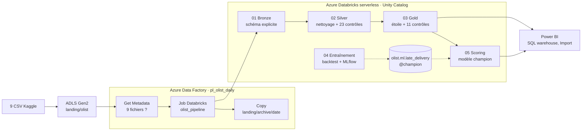
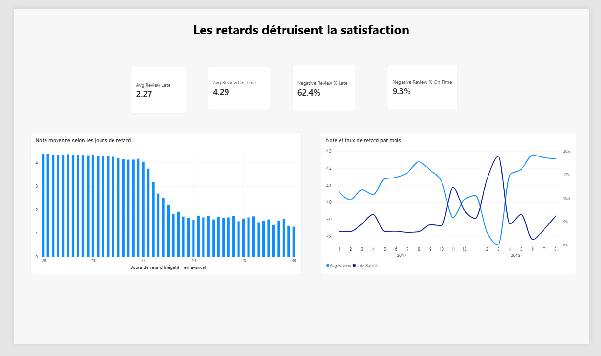
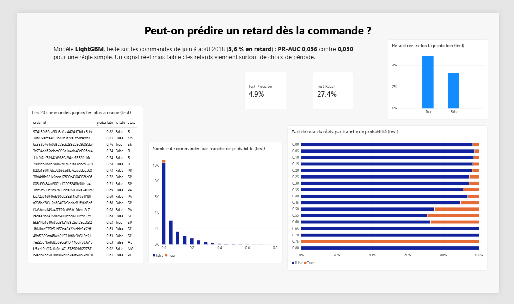
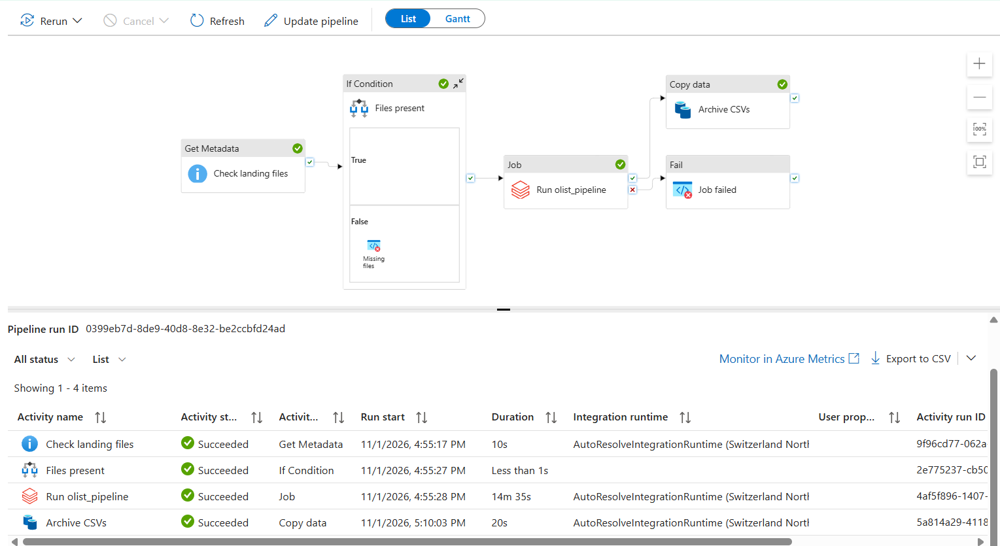
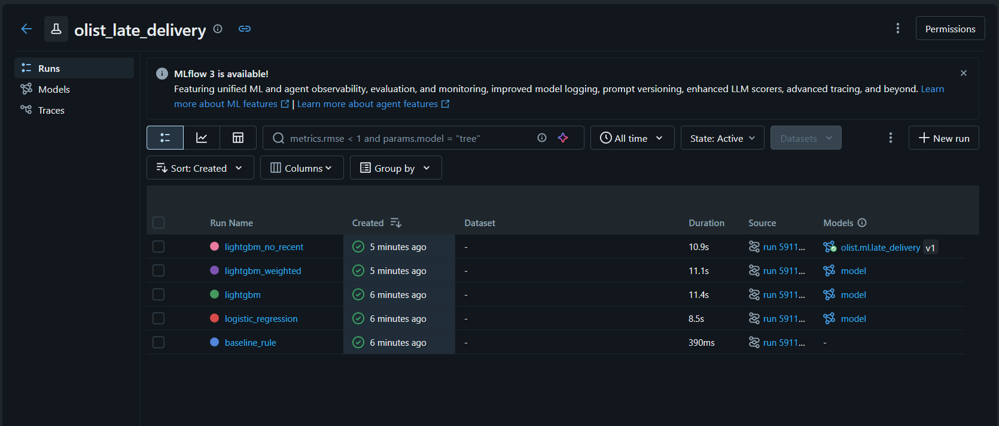

# Olist Lakehouse — Pipeline Data & ML sur Azure

[](https://github.com/Taki-eddine-El-Attari/olist-azure-lakehouse/actions/workflows/ci.yml)

Pipeline de données de bout en bout sur les **99 441 commandes** du dataset e-commerce brésilien Olist ([Kaggle : Brazilian E-Commerce Public Dataset by Olist](https://www.kaggle.com/datasets/olistbr/brazilian-ecommerce)) : ingestion orchestrée par **Azure Data Factory**, lakehouse **Bronze / Silver / Gold** en **PySpark + Delta Lake** sur **Azure Databricks** (serverless, Unity Catalog), schéma en étoile et rapport **Power BI**, modèle de prédiction des retards suivi dans **MLflow** et scoré en batch par le pipeline.

**Question métier :** les retards de livraison détruisent-ils la satisfaction, où, et peut-on les prédire dès la commande ?

## Résultats

- **6,77 %** des commandes livrées arrivent après le jour promis. Le chiffre de 8,1 % qui circule compte aussi en retard les 1 292 commandes livrées *le jour promis* : la date estimée est à minuit ([ADR-006](docs/decisions.md)).
- Note moyenne **2,27 / 5 en retard contre 4,29 à l'heure** ; **62 %** d'avis négatifs en retard contre **9 %** à l'heure.
- Pics de retard en novembre 2017 (12,4 %), février 2018 (14,1 %) et mars 2018 (19,0 %) ; de 21 % (AL) à 3 % (AM) selon l'état du client.
- **Prédiction dès la commande : un signal réel mais faible.** Sur la période de test (juin-août 2018, 3,6 % de retards), le modèle retenu (LightGBM) obtient une PR-AUC de **0,056** contre **0,050** pour une règle simple, avec 4,9 % de précision et 27,4 % de rappel. Les retards viennent surtout de chocs de période que les données de commande ne voient pas ([ADR-010](docs/decisions.md)).

Tous les chiffres viennent d'exécutions réelles (`sql/checks.sql`, contrôles qualité, runs MLflow) ; les mêmes résultats sont obtenus en local et sur Databricks.

## Architecture



- **Sécurité :** identités managées pour ADF (rôles limités au conteneur `landing` et au workspace) et pour Databricks vers le stockage (Access Connector) ; aucun secret dans Git.
- **Code :** toute la logique vit dans `src/olist` et est testée en local (Docker aligné sur Databricks) ; les notebooks ne font qu'appeler ces fonctions. Le même code a tourné sur Databricks sans modification.
- **Modèle Gold :** deux faits à grain différent (`fact_orders`, `fact_order_items`) partagent quatre dimensions ([schéma](docs/star_schema.svg)) ; aucun filtre bidirectionnel dans Power BI.

## Captures

| | |
|---|---|
|  |  |
|  |  |

Autres captures : [Power BI](powerbi/screenshots/) (4 pages, aussi en [PDF](powerbi/Olist.pdf)), [Azure et Databricks](docs/screenshots/).

## Ce que le projet montre

- **Qualité des données :** schémas explicites et lecture `FAILFAST` en Bronze ; 16 contrôles bloquants et 7 avertissements en Silver, résultats historisés dans `gold.dq_results` ; lignes invalides en quarantaine plutôt que supprimées ; 11 contrôles Gold qui font échouer le run (sommes Gold = Silver, taux de retard, notes). Défauts trouvés et traités : avis rattachés à plusieurs commandes (clé réelle `(review_id, order_id)`), catégories manquantes, écart de 165 319 BRL entre paiements et articles expliqué à 98 % par 775 commandes payées jamais expédiées.
- **ML sans fuite :** uniquement des informations connues au clic « acheter » ; l'historique d'un vendeur ne compte que les livraisons déjà faites avant l'achat (testé) ; split temporel, choix du modèle par backtest glissant sur 8 mois, test lu seulement pour le rapport. Les itérations où le test a été regardé sont listées dans l'ADR.
- **Orchestration :** ADF vérifie la présence des fichiers, lance le job serverless, archive les CSV ; une activité *Fail* remonte l'erreur du job. JSON versionné dans [`adf/`](adf/) par l'intégration Git d'ADF.
- **Ingénierie :** 29 tests pytest, CI GitHub Actions (ruff + pytest dans l'image Docker du projet), 11 décisions documentées dans [`docs/decisions.md`](docs/decisions.md).

## Coûts réels (Azure for Students)

- **≈ 7,9 USD du 26 au 31 octobre 2026** *(somme des relevés Cost analysis ; captures dans `docs/screenshots/cost_*.png`)*. Le premier run du job serverless (01 → 03) a coûté 0,22 USD ; ADF 0,06 USD pour sa journée de mise au point.
- Premier poste de coût : la **NAT Gateway** que Databricks crée pour un workspace *Hybrid* (~1,2 USD/jour même à l'arrêt), plus chère que tout le calcul. À refaire : un workspace *Serverless* d'emblée ([ADR-007](docs/decisions.md)).
- Total final : *à compléter après le relevé du 1er novembre et le nettoyage.*

## Reproduire

En local (Docker, versions alignées sur Databricks), avec les 9 CSV du [dataset Kaggle](https://www.kaggle.com/datasets/olistbr/brazilian-ecommerce) dans `data/raw/` (non versionnés) :

```bash
docker compose build
docker compose run --rm dev pytest
docker compose run --rm dev python -m olist.bronze
docker compose run --rm dev python -m olist.silver
docker compose run --rm dev python -m olist.gold
docker compose run --rm dev python -m olist.ml.train
docker compose run --rm dev python -m olist.ml.score
```

Sur Azure : [AZURE_SETUP.md](AZURE_SETUP.md), étape par étape (stockage, Unity Catalog, jobs serverless, ADF, Power BI). Cahier des charges et journal d'avancement : [CAHIER_DES_CHARGES.md](CAHIER_DES_CHARGES.md).

## Known gaps

- Le modèle bat la règle de base de peu ; la régression logistique fait mieux au test (0,074) mais n'a pas été promue après coup, ce serait choisir sur le test.
- Pas de recherche d'hyperparamètres, pas de SHAP ; le modèle final voit des retards de fin de période qu'on n'aurait pas encore connus à la date de coupure.
- Power BI s'authentifie par jeton d'accès personnel (compte Microsoft personnel refusé par Entra ID) ; pas de publication sur Power BI Service ([ADR-009](docs/decisions.md)).
- CI sans déploiement : pas de service principal OIDC sur ce compte ; les jobs se mettent à jour par le Git folder Databricks ([ADR-011](docs/decisions.md)).
- Clés de substitution `row_number` sur une partition unique : à remplacer par un hachage au-delà de quelques millions de lignes.

## En production, ou à 100× le volume

- Ingestion incrémentale (Auto Loader, `MERGE`) au lieu d'un `overwrite` complet ; partitionnement par date.
- Environnements dev / prod séparés, déploiement par Databricks Asset Bundles depuis la CI, identités fédérées.
- Réseau privé (VNet injection, Private Endpoints), comptes professionnels et SSO pour Power BI.
- Monitoring : alertes ADF, suivi des contrôles qualité, dérive du modèle et réentraînement mensuel ; signaux externes pour le ML (calendrier, capacité transporteurs, météo, grèves).
- Spark n'était pas nécessaire pour 100 000 lignes ; il l'est pour un pipeline qui doit passer à l'échelle.

## Structure

```
src/olist/        bronze, silver, quality, gold, ml/ (features, train, score)
notebooks/        01 → 05, fins wrappers Databricks
tests/            pytest (Spark local + pandas)
sql/checks.sql    contrôles Gold bloquants
adf/              pipeline, datasets, linked services (intégration Git d'ADF)
powerbi/          Olist.pbix, PDF, measures.dax, captures
docs/             decisions.md (ADR), interview_notes.md, schéma en étoile, captures
```
